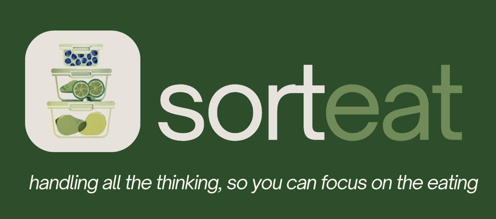

# Sorteat — BitBuilders

**Progetto universitario di Human-Computer Interaction · Politecnico di Milano · A.A. 2025/26**  
**Valutazione finale dichiarata nel README originario:** 30/30 e lode.

> *Handling all the thinking, so you can focus on the eating.*

Sorteat è un **concept di applicazione mobile per la gestione condivisa degli alimenti domestici**: coinquilini e famiglie possono coordinare inventario, scadenze, spesa e pasti. Il progetto nasce da una ricerca sui problemi quotidiani di gestione, comunicazione e spreco alimentare.

### Esplora

- **[Sito del progetto](docs/index.html)** — unica sorgente del sito per GitHub Pages.
- **[Prototipo high-fidelity (live)](https://sorteat-high-fidelity.vercel.app/)** — app dimostrativa React esterna a questa repository.
- **[Sorgente del prototipo React](https://github.com/mariisarbash/sorteat_high_fidelity)** — repository separata; il codice non è incluso in questo archivio.
- **[Raccolta completa PDF](docs/pdf/)** — documenti e presentazioni conservati una sola volta.

## Team

- Mariia Sarbash
- Sofia Grumelli
- Marco Angelo Ruggieri
- Anthony Gerardo Giuliano
- Massimiliano Ferretti
- Jacopo Ascanio Roncato

**Crediti:** ricerca, valutazione e deliverable sono il risultato del lavoro collettivo del team BitBuilders. Il sito statico è attribuito a **Mariia Sarbash** dal README di `sorteat_website`. Nella medesima fonte Mariia descrive un contributo alla direzione UX/UI e alla realizzazione del prototipo high-fidelity: questa repository non contiene il codice React necessario per verificarne in modo indipendente la ripartizione.

## Processo e deliverable

| Fase | Attività | Materiali locali |
|---|---|---|
| **01 — Needfinding** | Interviste iniziali, esplorazione dei bisogni e analisi | [Documentazione](docs/pdf/01-needfinding-documentazione.pdf) · [Presentazione](docs/pdf/01-needfinding-presentazione.pdf) |
| **02 — Raffinamento e focus** | Approfondimento di temi e bisogni con interviste e focus group | [Documentazione](docs/pdf/02-raffinamento-documentazione.pdf) · [Presentazione](docs/pdf/02-raffinamento-presentazione.pdf) |
| **03 — Task e storyboard** | Scenari d'uso e due proposte low-fidelity, smartphone e smartwatch | [Documentazione](docs/pdf/03-task-storyboard-prototipi.pdf) |
| **04 — Prototipo mid-fidelity** | Iterazione del design e materiale per valutatori | [Scelte progettuali](docs/pdf/04-scelte-progettuali.pdf) · [Brief valutatori](docs/pdf/04-brief-valutatori-esterni.pdf) |
| **05 — Valutazione euristica** | Valutazione **condotta da BitBuilders su StrandU**, un altro progetto | [Valutazione di StrandU](docs/pdf/05-valutazione-euristica-strandu.pdf) |
| **06 — Redesign e test** | Correzioni dopo la valutazione di Sorteat **ricevuta da EcoDevs**; protocollo e test utenti sul prototipo high-fidelity | [Correzioni](docs/pdf/06-correzione-prototipo.pdf) · [Protocollo](docs/pdf/06-protocollo-usability-testing.pdf) · [Report](docs/pdf/06-report-usability-testing.pdf) |

Altri link originali (Canva, Figma, FigJam, sito precedente) sono disponibili nella [raccolta delle risorse esterne](materiali/link-e-fonti.md) e sul sito del progetto.

### Ricerca e valutazione

- **13 partecipanti** contattati nella fase iniziale di ricerca.
- **Due focus group** con **6 persone** in totale.
- **11 partecipanti** al test finale di usabilità, con **11 task** e think-aloud.
- **SUS medio: 89/100** sul prototipo testato (secondo il report del team).

Sono risultati di uno studio accademico sul prototipo, **non** una misura di diffusione commerciale o di riduzione effettiva degli sprechi.

## Ambito del prototipo

Il prototipo high-fidelity usa React e include quattro aree: **Home**, **Inventario**, **Spesa**, **Cucina**. Nello stato documentato dal README originale si tratta di una demo con dati in memoria, un utente simulato e funzioni di scansione scontrini e input vocale simulate. Il codice React rimane nella repository esterna linkata sopra.

## Struttura della repository

```text
Sorteat-unified/
├── README.md
├── cover.png
├── .gitignore
├── docs/                   # unica sorgente del sito GitHub Pages
│   ├── index.html
│   ├── style.css
│   ├── images/             # logo + foto del team
│   └── pdf/                # tutti i documenti, senza duplicazioni
└── materiali/
    ├── link-e-fonti.md
    └── MIGRATION.md
```

Nessuna dipendenza, build o framework per il sito statico. Per vedere l'anteprima aprire `docs/index.html` oppure usare un server statico locale.

### Pubblicazione su GitHub Pages

1. Crea una repository o aggiorna quella scelta e copia **il contenuto** di questa cartella nella root.
2. Esegui commit e push sul branch `main`.
3. Vai in **Settings → Pages**, seleziona **Deploy from a branch**, branch `main` e cartella **`/docs`**.
4. Controlla la navigazione e i collegamenti esterni. Il link in alto **“Repo del team”** punta per scelta alla repository originale `PorkyPhoenix091/BitBuilders`; aggiornalo se desideri indicare invece la nuova repository.

**Attenzione alla privacy:** gli archivi originali contengono foto del team e materiale di ricerca. Prima di rendere pubblico il sito verifica i consensi appropriati e che i PDF non contengano informazioni che i partecipanti non hanno autorizzato a condividere. I moduli firmati non sono inclusi.

## Provenienza

Unificazione dei contenuti forniti dall'utente negli archivi `BitBuilders-main(1).zip` e `sorteat_website-main.zip`. Il sito originale **BitBuilders** è la base della versione consolidata; il sito `sorteat_website` era una variante precedente e non viene duplicato. Il processo e i documenti sono preservati senza riscrivere i PDF originali.
